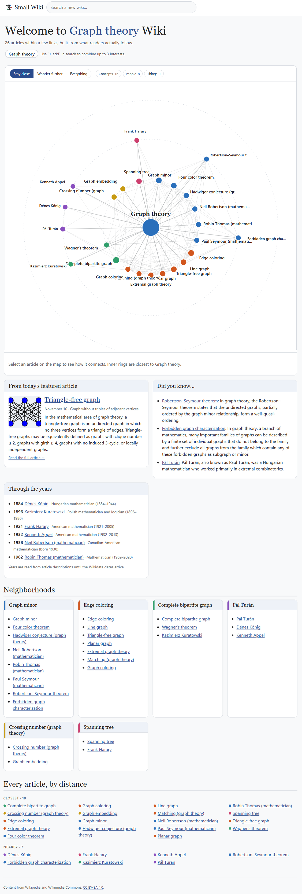

# Small Wiki

Turn any interest into a self-contained small wiki: a ring map of the articles a few links away, plus a front page built only from them.

**Live site:** [nreff.github.io/small-wiki](https://nreff.github.io/small-wiki/)

Pick one to three English Wikipedia articles as seeds. Small Wiki finds the neighborhood around them, down-weights generic hub pages so the interesting material shows up, and lays it out as a map and a front page. Every fact comes from Wikipedia, with a link to the source article. No LLM is involved at any step.



> **Status: live prototype.** Neighborhoods are built in your browser from the Wikipedia API, so a first visit takes a little while. Repeat visits are cached.

## Where this came from

Inspired by [Localpedia](https://edjefferson.com/localpedia/), Ed Jefferson’s Wikipedia of only what is a short walk away. This project generalizes that idea from one place to any article, and treats the neighborhood as a knowledge graph you can walk.

## Quick start

Requires Node 20+.

```sh
npm install
npm run dev        # http://localhost:5173
```

Try `/wiki/Jazz`, `/wiki/Quadrivium`, or combine interests with `/wiki/Juggling+Mathematics`.

| Command | What it does |
| --- | --- |
| `npm run dev` | Bundle, watch and serve on :5173, with SPA fallback for `/wiki/...` routes |
| `npm run build` | Minified production bundle in `dist/` |
| `npm run check` | Typecheck with `tsc` |
| `npm run try -- "Jazz"` | Build one neighborhood in Node and print it |

## What you get

- **Neighborhood map.** An SVG ring map: the seed in the center, closest articles on the inner ring, further ones outside. Related articles share a color. Layout is stable, and nodes are keyboard-focusable.
- **Radius control.** *Stay close*, *Wander further*, or *Everything*. Changing it needs no new fetch.
- **Variety rule.** No single kind of article takes over the map. Kind chips hide a kind without reshuffling what is left.
- **Front page.** Welcome banner, a featured article that rotates daily, Did you know, Trending, Through the years, neighborhood lists, and every article grouped by distance.
- **Up to three seeds.** Each seed keeps its own color, and articles that connect them are called out.
- **Local article pages.** Articles open inside the app using Wikipedia's own HTML. Links to neighborhood articles stay local; everything else goes to Wikipedia. Attribution (CC BY-SA 4.0) appears on every article page.
- **Build around any node.** Select a node and choose *Build a wiki around this*. The previous wiki stays in history, so the back button returns to it.
- **Shareable routes.** `/wiki/Jazz`, `/wiki/Juggling+Mathematics`, `?r=2` for radius, `?a=Bebop` for an article.

## Project layout

```
src/
  main.ts          routing, rendering, search, events
  live.ts          neighborhood building
  prose.ts         link extraction from rendered article HTML
  combine.ts       merge one to three neighborhoods
  neighborhood.ts  radius presets and the daily featured pick
  map.ts           ring layout and SVG rendering
  article.ts       Wikipedia HTML with link rewriting
  trending.ts      Pageviews API, cached for an hour
  api.ts           Wikipedia API client
  kind.ts          kind guessed from short descriptions
scripts/try.mjs    build one neighborhood in Node and print it
build.mjs          esbuild bundle and dev server
```

## Known limits of the prototype

- **Speed.** A first build talks to Wikipedia for a while. Repeat visits are instant.
- **Trending** can hit rate limits and then hides itself.
- **Kinds** are guessed from short descriptions, so some are wrong.
- **Through the years** is often sparse.

## Data and licensing

All content comes from Wikipedia and Wikimedia through public APIs. Article text and images are available under [CC BY-SA 4.0](https://creativecommons.org/licenses/by-sa/4.0/) and credited in the app. Small Wiki is not affiliated with the Wikimedia Foundation.
